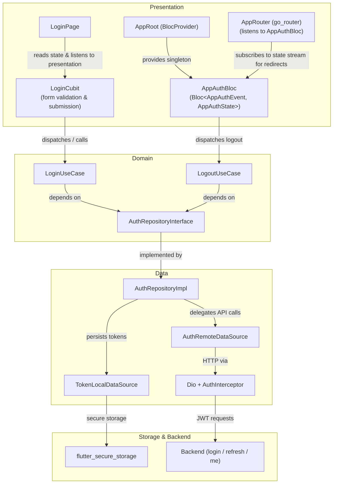

# Flutter JWT + Event-Driven Bloc Authentication Pattern

## Overview

Self-hosted JWT authentication (no Firebase, no third-party auth provider): a backend issues access/refresh tokens, the Flutter app stores them via `flutter_secure_storage`, attaches them to requests via a `Dio` interceptor, and enforces RBAC route guards via `go_router`.

## Core Architectural Principle

> **Reserve event-driven Bloc (`Bloc<Event, State>`) for global, app-root session state only.** Everything else: feature/page-level state, should use Cubit (`Cubit<State>`). Authentication is a natural fit for the Bloc exception because session state is global, event-driven (login, logout, external invalidation), and outlives any single screen.

This keeps the state-management story simple: one Bloc at the root for "who is logged in," Cubits everywhere else for page-local concerns.

## Architecture



## Domain Layer

```dart
abstract class AuthRepositoryInterface {
  Future<Result<AuthSession, Exception>> login({required String identifier, required String secret});
  Future<Result<AuthSession, Exception>> refreshToken(String refreshToken);
  Future<Result<UserEntity, Exception>> getCurrentUser();
  Future<void> saveSession(AuthSession session);
  Future<AuthSession?> getSavedSession();
  Future<void> clearSession();
  Future<bool> isAuthenticated();
}

class LoginUseCase {
  const LoginUseCase({required AuthRepositoryInterface authRepository})
      : _authRepository = authRepository;
  final AuthRepositoryInterface _authRepository;

  Future<Result<AuthSession, Exception>> call({required String identifier, required String secret}) =>
      _authRepository.login(identifier: identifier, secret: secret);
}
```

`UserRole` is a project-defined enum (see the consuming project's own auth skill for its concrete role set) used both for `AuthSession`/`UserEntity` and for RBAC route guards below.

## AppAuthBloc (global session state)

```dart
@freezed
class AppAuthEvent with _$AppAuthEvent {
  const factory AppAuthEvent.userSubscriptionRequested() = _UserSubscriptionRequested;
  const factory AppAuthEvent.loginSubmitted({required String identifier, required String secret}) = _LoginSubmitted;
  const factory AppAuthEvent.logoutRequested() = _LogoutRequested;
  const factory AppAuthEvent.authStatusChanged(AuthSession? session) = _AuthStatusChanged;
}

@freezed
class AppAuthState with _$AppAuthState {
  const factory AppAuthState.initial() = _Initial;
  const factory AppAuthState.loading() = _Loading;
  const factory AppAuthState.authenticated(AuthSession session) = _Authenticated;
  const factory AppAuthState.unauthenticated() = _Unauthenticated;
  const factory AppAuthState.error(String message) = _Error;
}

@lazySingleton
class AppAuthBloc extends Bloc<AppAuthEvent, AppAuthState> {
  AppAuthBloc({required AuthRepositoryInterface authRepository})
      : _authRepository = authRepository,
        super(const AppAuthState.initial()) {
    on<_UserSubscriptionRequested>(_onUserSubscriptionRequested);
    on<_LoginSubmitted>(_onLoginSubmitted);
    on<_LogoutRequested>(_onLogoutRequested);
    on<_AuthStatusChanged>(_onAuthStatusChanged);
  }

  final AuthRepositoryInterface _authRepository;

  Future<void> _onUserSubscriptionRequested(_UserSubscriptionRequested event, Emitter<AppAuthState> emit) async {
    emit(const AppAuthState.loading());
    final session = await _authRepository.getSavedSession();
    emit(session != null ? AppAuthState.authenticated(session) : const AppAuthState.unauthenticated());
  }

  Future<void> _onLoginSubmitted(_LoginSubmitted event, Emitter<AppAuthState> emit) async {
    emit(const AppAuthState.loading());
    final result = await _authRepository.login(identifier: event.identifier, secret: event.secret);
    result.when(
      (session) => emit(AppAuthState.authenticated(session)),
      (error) => emit(AppAuthState.error(error.toString())),
    );
  }

  Future<void> _onLogoutRequested(_LogoutRequested event, Emitter<AppAuthState> emit) async {
    await _authRepository.clearSession();
    emit(const AppAuthState.unauthenticated());
  }

  void _onAuthStatusChanged(_AuthStatusChanged event, Emitter<AppAuthState> emit) {
    emit(event.session != null ? AppAuthState.authenticated(event.session!) : const AppAuthState.unauthenticated());
  }
}
```

**Important pitfall:** if `AppAuthBloc` (or anything resolved eagerly at DI-container setup, e.g. an interceptor attached to `Dio` before `runApp`) gets injected into another eagerly-resolved singleton's *constructor*, it forces `AppAuthBloc` to build: and fire its startup event, before the widget tree mounts. Any `BlocListener` waiting on that Bloc's *future* state changes will never see the already-settled state and can hang (e.g. a splash screen stuck on `pumpAndSettle`). Prefer resolving such rare/late dependencies lazily at the point of use (a service-locator call inside the failure path) instead of via constructor injection.

## LoginCubit (page-local, form-level)

Separate from `AppAuthBloc`: handles form field state and submission UX for the login page itself, then lets `AppAuthBloc` own the resulting session.

```dart
class LoginCubit extends Cubit<LoginState> with BlocPresentationMixin {
  LoginCubit({required LoginUseCase loginUseCase})
      : _loginUseCase = loginUseCase,
        super(const LoginState());

  final LoginUseCase _loginUseCase;

  Future<void> submit() async {
    emit(state.copyWith(status: LoginStatus.loading));
    final result = await _loginUseCase(identifier: state.identifier, secret: state.secret);
    result.when(
      (session) => emit(state.copyWith(status: LoginStatus.success)),
      (error) {
        emit(state.copyWith(status: LoginStatus.error, errorMessage: error.toString()));
        emitPresentation(const LoginCubitEvent.loginFailed());
      },
    );
  }
}
```

Use `bloc_presentation` (`BlocPresentationMixin` + `emitPresentation`) for one-shot UI feedback (snackbars, dialogs) instead of encoding it in state: keeps state free of side-effect flags.

## Dio AuthInterceptor (attach + refresh-and-retry)

```dart
class AuthInterceptor extends Interceptor {
  AuthInterceptor({
    required TokenLocalDataSource tokenStorage,
    required AuthRemoteDataSource authRemote,
    required Dio dio,
  }) : _tokenStorage = tokenStorage, _authRemote = authRemote, _dio = dio;

  final TokenLocalDataSource _tokenStorage;
  final AuthRemoteDataSource _authRemote;
  final Dio _dio;

  @override
  void onRequest(RequestOptions options, RequestInterceptorHandler handler) async {
    final session = await _tokenStorage.getSavedSession();
    if (session != null) {
      options.headers['Authorization'] = 'Bearer ${session.accessToken}';
    }
    handler.next(options);
  }

  @override
  void onError(DioException err, ErrorInterceptorHandler handler) async {
    if (err.response?.statusCode == 401) {
      final session = await _tokenStorage.getSavedSession();
      if (session != null && session.refreshToken.isNotEmpty) {
        try {
          final refreshed = await _authRemote.refreshToken(session.refreshToken);
          await _tokenStorage.saveTokens(refreshed.toEntity());
          final opts = err.requestOptions
            ..headers['Authorization'] = 'Bearer ${refreshed.accessToken}';
          handler.resolve(await _dio.fetch(opts));
          return;
        } catch (_) {
          await _tokenStorage.clearTokens();
        }
      }
    }
    handler.next(err);
  }
}
```

**Critical gap to check for:** clearing tokens on refresh failure is not enough: the app must also *broadcast* the invalidation (e.g. dispatch `AppAuthEvent.authStatusChanged(null)` to `AppAuthBloc`) so route guards react and redirect to login. Without this, the interceptor silently clears session while the UI stays on a now-broken authenticated screen.

## go_router RBAC Guard

```dart
final GoRouter router = GoRouter(
  initialLocation: '/splash',
  redirect: (context, state) async {
    final isLoggedIn = context.read<AppAuthBloc>().state.maybeWhen(
      authenticated: (_) => true,
      orElse: () => false,
    );
    final location = state.uri.toString();

    if (location == '/splash' || location == '/login') {
      return (isLoggedIn && location == '/login') ? '/home' : null;
    }
    if (!isLoggedIn) return '/login';

    final requiredRoles = routeRoles[location];
    if (requiredRoles != null && !requiredRoles.contains(currentUserRole)) {
      return '/unauthorized';
    }
    return null;
  },
);
```

`routeRoles` is a project-defined `Map<String, Set<UserRole>>`: define the concrete role set and route mapping per app.

## Feature Comparison: Bloc vs Cubit

| Aspect | Auth (Bloc) | Everything else (Cubit) |
|---|---|---|
| State management | Event-driven `Bloc<Event, State>` | `Cubit<State>` |
| Scope | Application root | Feature / page level |
| State lifecycle | Global session lifetime | Screen / feature lifecycle |
| Router binding | Direct `go_router` redirect stream listener | Declarative page routes |
| DI registration | `@lazySingleton` / `@singleton` | `@injectable` / `@factoryParam` |

## Testing Patterns

```dart
blocTest<AppAuthBloc, AppAuthState>(
  'emits [loading, authenticated] when a saved session exists',
  build: () {
    when(() => repository.getSavedSession()).thenAnswer((_) async => tSession);
    return AppAuthBloc(authRepository: repository);
  },
  act: (b) => b.add(const AppAuthEvent.userSubscriptionRequested()),
  expect: () => [const AppAuthState.loading(), AppAuthState.authenticated(tSession)],
);

blocTest<LoginCubit, LoginState>(
  'emits [loading, success] when login succeeds',
  build: () {
    when(() => useCase(identifier: any(named: 'identifier'), secret: any(named: 'secret')))
        .thenAnswer((_) async => Success(tAuthSession));
    return LoginCubit(loginUseCase: useCase);
  },
  act: (cubit) => cubit.submit(),
  expect: () => [
    predicate<LoginState>((s) => s.status == LoginStatus.loading),
    predicate<LoginState>((s) => s.status == LoginStatus.success),
  ],
);
```

Widget tests exercising a page that navigates via `context.push`/`pushNamed` need a real `GoRouter` in the test harness (a plain `MaterialApp` without a router will throw): including a registered route `name:` if production code navigates by name rather than by path.
